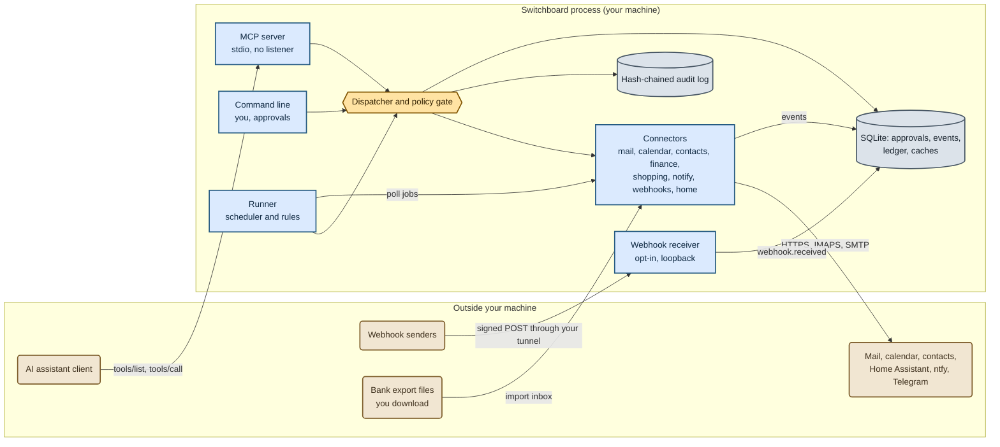

# Architecture

Switchboard is a small, self-hosted program that gives AI assistants guarded access to your own accounts:
mail, calendars, contacts, bank data, orders, notifications, inbound webhooks, and home devices. It replaces
paid intermediaries (aggregators such as Plaid, automation services such as Zapier) with code you can read,
running on a machine you control, using only the Python standard library.

## Design principles

1. **No paid middlemen, no third party holding your credentials.** Connectors speak open protocols directly
   (IMAP, SMTP, CalDAV, CardDAV, OFX files, HTTPS APIs you own) or use data you already receive (bank alert
   emails, order emails).
2. **Assistants are untrusted callers.** An assistant can read what you expose, prepare drafts, and *ask*
   to act. Sending, creating, or changing anything outside the machine needs your approval by default, and
   moving money has no tool at all.
3. **Every path goes through one gate.** Calls from an assistant, from an automation rule, and from your own
   command line take the same route: schema validation, policy decision, audit record, then execution.
4. **Least privilege by default.** Read-only protocol modes, recipient allowlists, rate limits, a kill switch,
   and per-tool exposure lists. Secrets are references, never values in the configuration.
5. **Small and auditable.** No runtime dependencies. Each connector is a separate package with its own tests.

## Components

Legend: tan nodes are outside your control, blue nodes are Switchboard entry points and connectors, the yellow
hexagon is the single gate every call passes, and gray cylinders are local storage in a directory only you can
read (mode 700). The diagram was written for Markdown previews with Mermaid support; it has not been visually
checked in every renderer.

| Component        | Module                      | Responsibility                                                                                                                   |
| ---------------- | --------------------------- | -------------------------------------------------------------------------------------------------------------------------------- |
| Configuration    | `config.py`, `secrets.py`   | TOML settings; `env:`, `file:` (mode 600, no symbolic links), and `cmd:` secret references                                       |
| Storage          | `db.py`                     | One SQLite file, write-ahead logging, versioned migrations per component                                                         |
| Audit log        | `audit.py`                  | Append-only JSON lines; each record hashes the previous one; redacts credentials and bodies                                      |
| Policy gate      | `policy.py`                 | Tier defaults, per-tool rules, recipient allowlists, amount caps, rate limits, kill switch                                       |
| Tools            | `tools.py`, `jsonschema.py` | Tool registry, argument validation, the dispatcher every call goes through                                                       |
| Approvals        | `approvals.py`              | Queue binding the exact arguments; one atomic claim; expiry                                                                      |
| Events and rules | `events.py`, `rules.py`     | Durable event queue; connector subscribers; "when this, do that" rules through the gate                                          |
| Scheduler        | `scheduler.py`              | Interval polling jobs (at least 30 seconds apart)                                                                                |
| HTTP             | `httpclient.py`             | HTTPS-only client; no downgrade redirects; drops credentials on cross-host redirects; `public_only` refuses non-public addresses |
| MCP server       | `mcp_server.py`             | Dual-era Model Context Protocol over stdio (`2026-07-28` and `2025-11-25` or earlier)                                            |
| Command line     | `cli.py`                    | Setup, diagnostics, approvals, audit, kill switch, runner, connector subcommands                                                 |

## The path of every call

Legend: yellow diamonds are decisions, green is execution, red is refusal, and the dotted edges show audit
writes that happen alongside the main flow.

Default decisions by tier:

| Tier    | Meaning                                    | Default | Examples                                                    |
| ------- | ------------------------------------------ | ------- | ----------------------------------------------------------- |
| `read`  | Look at data; no outside effect            | allow   | search mail, agenda, ledger queries, order status           |
| `draft` | Prepare something you finish yourself      | allow   | save a mail draft, propose an event as an invite draft      |
| `act`   | Send, create, or change something outside  | ask     | send mail, create a calendar event, switch a home device    |
| `spend` | Move or commit money                       | deny    | none implemented; see [tradeoffs](./TRADEOFFS.md)           |

Your own command-line calls turn *ask* into *allow* (typing the command is the approval), but never override
*deny*. Approvals execute the stored arguments, so an assistant cannot change a recipient after you agree.

## Event-driven automation

Polling jobs and the webhook receiver write events to SQLite (`mail.received`, `webhook.received`, …).
The runner (`switchboard run`) delivers each event first to connector subscribers, which may derive new
events (a bank alert email becomes `finance.transaction`), then to your `[[rules]]`. Rule actions are tool
calls with origin `rule`, so they meet the same policy: a rule can notify you freely but cannot send mail to
someone else without your approval unless you configure that explicitly.

## Trust boundaries and threats

| Boundary                      | Threat                                                                        | Control                                                                              |
| ----------------------------- | ----------------------------------------------------------------------------- | ------------------------------------------------------------------------------------ |
| Assistant to Switchboard      | Prompt injection makes the assistant request harmful actions                  | Tiers, approvals with bound arguments, allowlists, rate limits, exposure list, audit |
| External content to assistant | Emails and pages contain instructions                                         | Content is returned as data marked untrusted; nothing in content can choose a tool   |
| Switchboard to providers      | Credential theft or misuse                                                    | Secret references, read-only modes, HTTPS only, no credentials across redirect hosts |
| Web pages to your network     | A watched page redirects to an internal address (server-side request forgery) | Every redirect vetted again, `public_only` address checks, HTTPS certificates        |
| Internet to webhook receiver  | Forged or replayed notifications                                              | Loopback bind, your own tunnel, signatures, timestamps, replay cache, size limits    |
| Local disk                    | Other users reading data                                                      | Mode 700 data directory, mode 600 files, owner checks on secret files                |
| Your own mistakes             | A bad rule or approval                                                        | Kill switch, deny rules that override approvals, approval expiry, audit verification |

The audit log is tamper-evident, not tamper-proof: anyone who can rewrite the whole file can recompute the
chain. Keep a copy of the latest hash elsewhere if you need stronger evidence.

## Connectors

See the [connector guide](./CONNECTOR_GUIDE.md) for the contract and the per-connector pages in
[`docs/connectors/`](./connectors/) for setup, tools, events, and limits.
