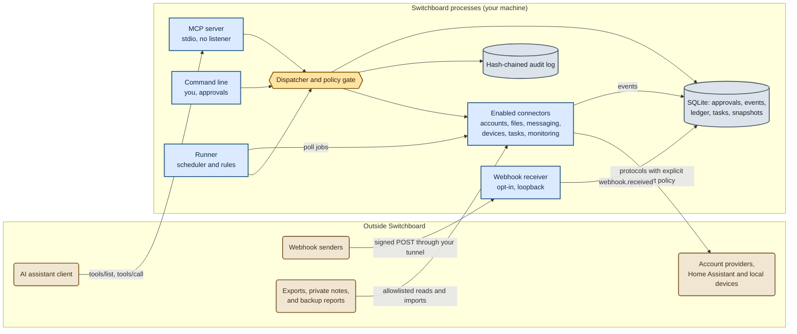
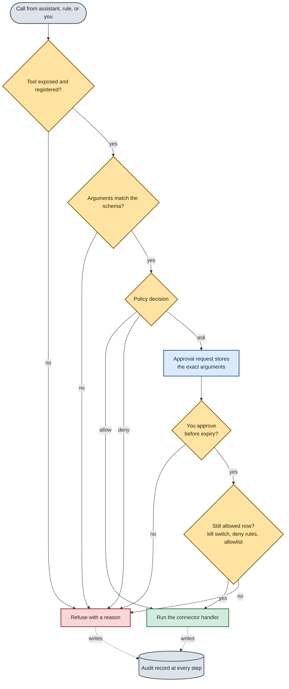

# Architecture

Switchboard is a self-hosted program that gives artificial intelligence (AI) assistants guarded access to your
own accounts:
mail, calendars, contacts, bank data, orders, notifications, inbound webhooks, and home devices. It replaces
paid intermediaries (aggregators such as Plaid, automation services such as Zapier) with code you can read,
running on a machine you control. The fuller Python reference uses only its standard library; the separate
C++20 native backend uses established transport, database, structured-data and cryptographic libraries.
The Model Context Protocol (MCP)
server communicates over standard input and output (stdio).

## Design principles

1. **No paid middlemen, no third party holding your credentials.** Connectors speak open protocols directly
   for mail, calendars, and contacts, import downloaded bank statements, or use data you already receive
   (bank alert emails, order emails).
2. **Assistants are untrusted callers.** An assistant can read what you expose, prepare drafts, and *ask*
   to act. Sending, creating, or changing anything outside the machine needs your approval by default, and
   moving money has no tool at all.
3. **Every tool call goes through one gate.** Calls from an assistant, from an automation rule, and from your own
   command line take the same route: schema validation, policy decision, audit record, then execution.
4. **Least privilege by default.** Read-only protocol modes, recipient allowlists, rate limits, a kill switch,
   and per-tool exposure lists. Secrets are references, never values in the configuration.
5. **Explicit implementation boundaries.** Python has no third-party runtime packages. Native C++ code uses
   reviewed libraries, with C and Rust clients sharing the same native gate rather than duplicating it.
   The native subset and independent state are documented; unsupported Python features are not hidden fallbacks.

## Language implementations

[The native backend](../native/README.md) is preferred for new local-first native development.
Its C++ engine implements actual policy, private state and supported adapters. A stable C application binary
interface and safe Rust ownership wrapper use that engine without launching Python.

This is not complete feature parity: the account/social connectors and full automation-rule runner remain
Python-only. Native configuration, state, approval identifiers and configuration hashes are separate.
Read [the native coverage table](../native/README.md#coverage) before changing an assistant's server command.

## Components

Legend: tan nodes are external to Switchboard, blue nodes are its entry points and connectors, the yellow
hexagon is the gate every tool call passes, and gray cylinders are local storage in a directory only you can
read (mode 700). The diagram was written for Markdown previews with Mermaid support; it has not been visually
checked in every renderer.

| Component        | Module                      | Responsibility                                                                                                                   |
| ---------------- | --------------------------- | -------------------------------------------------------------------------------------------------------------------------------- |
| Configuration    | `config.py`, `secrets.py`   | Table-based settings; `env:`, `file:` (mode 600, no symbolic links), and `cmd:` secret references                                |
| Storage          | `db.py`                     | One SQLite file, write-ahead logging, versioned migrations per component                                                         |
| Audit log        | `audit.py`                  | Hash-chained records; redacts credential-like keys but can retain message text and body prefixes                                 |
| Policy gate      | `policy.py`                 | Tier defaults, per-tool rules, recipient allowlists, amount caps, rate limits, kill switch                                       |
| Tools            | `tools.py`, `jsonschema.py` | Tool registry, argument validation, the dispatcher every call goes through                                                       |
| Approvals        | `approvals.py`              | Queue binding the exact arguments; one atomic claim; expiry                                                                      |
| Events and rules | `events.py`, `rules.py`     | Durable event queue; connector subscribers; "when this, do that" rules through the gate                                          |
| Scheduler        | `scheduler.py`              | Interval polling jobs (at least 30 seconds apart)                                                                                |
| Web transport    | `httpclient.py`             | Controlled redirects; public-only requests pin validated addresses and bypass proxies                                            |
| MCP server       | `mcp_server.py`             | Targets `2026-07-28`, `2025-11-25`, `2025-06-18`, and `2025-03-26`; not certified against clients                                |
| Command line     | `cli.py`                    | Setup, diagnostics, approvals, audit, kill switch, runner, connector subcommands                                                 |

## The path of every tool call

Legend: yellow diamonds are decisions, green is execution, red is refusal, and the dotted edges show audit
writes that happen alongside the main flow.

Default decisions by tier:

| Tier    | Meaning                                    | Default | Examples                                                    |
| ------- | ------------------------------------------ | ------- | ----------------------------------------------------------- |
| `read`  | Retrieve data; may fetch and cache it      | allow   | search mail, agenda, ledger queries, order status           |
| `draft` | Save prepared content or notify yourself   | allow   | save a mail draft, propose an event, notify your channels   |
| `act`   | Send, create, or change something outside  | ask     | send mail, create a calendar event, switch a home device    |
| `spend` | Move or commit money                       | deny    | none implemented; see [tradeoffs](./TRADEOFFS.md)           |

Your own command-line calls turn *ask* into *allow* (typing the command is the approval), but never override
*deny*. Approvals execute the stored arguments, so an assistant cannot change a recipient after you agree.
They revalidate the current tool schema and policy before execution. The rolling one-hour limit includes
successful and in-flight calls, including approvals, with atomic capacity reservations across processes.
An interrupted reservation expires from the budget after one hour; an external effect may already have
happened before the interruption.

The local user account is the operator trust boundary, not a way to prove a human is present. An assistant
with unrestricted shell access as that account can bypass the gate or approve its own request.

## Event-driven automation

Polling jobs and the webhook receiver write events to SQLite (`mail.received`, `webhook.received`, …).
The runner (`switchboard run`) delivers each event first to connector subscribers, which may derive new
events (a bank alert email becomes `finance.transaction`), then to your `[[rules]]`. Rule actions are tool
calls with origin `rule`, so they meet the same policy: a rule can notify you freely but cannot send mail to
someone else without your approval unless you configure that explicitly.

Polling and connector-to-connector service calls do not each pass through the dispatcher. They are trusted
application code; their derived rule actions do pass through it. The kill switch blocks non-read tool calls,
not the scheduler, read-side network requests, or the webhook listener.

Queued events survive restarts, but subscriber and rule effects are not one transaction. A crash can repeat
earlier effects, and a handler exception is recorded without automatic retry. Inspect processing failures
with `switchboard events --failed`; tool error outcomes returned to rules are visible as `rule.fired` audit
records. There is no exactly-once or automatic recovery guarantee.

Source adapters can enqueue an event inside their own database transaction with
`ctx.events.emit(..., connection=conn)`. Telegram uses this for inbox rows and the next update offset;
export imports use it for snapshot rows, the import marker, and a summary event. This closes a local
state/event gap, not the gap between a database commit and an external provider accepting a post or reply.

### Worked case: a pending action is not a completed workflow

Assume mail sending is enabled for an account and `mail_send` retains its default ask policy. A rule submits
a message, followed by a notification saying "message sent". The first call can return `pending` without
sending anything. `RuleEngine.__call__` treats that as a queued request, not an error, and proceeds to the
next action. The notification could therefore announce a send that has not happened.

The tempting assumption is that an ordered list of actions waits for each real-world operation to finish.
It does not: these are ordered dispatches, not a workflow with dependencies. Use "send requested" when that
is all the observed status establishes, or check the approval's final result after the user acts. Approval
executes the stored tool request; it does not automatically resume a dependent workflow.

Inspect `RuleEngine.__call__` in [rules.py](../src/switchboard/rules.py), `CallOutcome.is_error` and
`Dispatcher.approve` in [tools.py](../src/switchboard/tools.py), and the authored pending-action case in
[test_core_rules.py](../tests/unit/test_core_rules.py). This is a source-derived explanation. The tests have
not been executed on the authoring host, and no mail was sent to establish this example.

## Messaging and historical exports

The [Telegram connector](./connectors/telegram.md) is a pull-based bridge. The runner receives allowlisted
updates and stores an inbox. An existing assistant reads that inbox through tools, proposes actions,
and submits replies through the same gate. No model or assistant process is launched by an incoming message.
Reply destinations bind to stored messages, and uncertain delivery is not automatically retried.

[LinkedIn](./connectors/linkedin.md) and [WhatsApp](./connectors/whatsapp.md) imports are different: they are
historical, editable snapshots. The archive helper reads bounded text without extracting files to disk.
Imported messages do not each become a live instruction event. LinkedIn can additionally publish an
immutable local post draft, but only when publishing is explicitly enabled and the exact content, actor,
and version are approved. WhatsApp has no live messaging implementation.

All three add private data to the local store. Calling a tool can still disclose its results to a hosted
assistant; the transport does not make the assistant or its model local.

## Local devices, private files, and reminders

The [home bridge](./connectors/home.md) delegates device protocols to an operator-managed Home Assistant
server. [WLED](./connectors/wled.md) and [Shelly](./connectors/shelly.md) are separate direct local
adapters. No firmware installer, radio-commissioning client, or Home Assistant launcher is included.
New typed controls narrow target and parameter choices; exposing the older generic service tool is a
broader capability and must be a deliberate choice.

Action acknowledgement, observed software state, and actual physical effect are different evidence.
A readback can be unavailable, stale, delayed, or report only part of an intended transition. Callers must
preserve requested/unconfirmed/error outcomes instead of announcing completion from a successful
request alone. Hardware interlocks and manual control remain independent of model reasoning.
An outer tool `status = "ok"` or approval state `executed` means the handler returned a report, not
that a physical action was independently confirmed. Inspect the returned acceptance and observation
fields before describing the result or requesting another operation.

[Documents](./connectors/documents.md) reads selected local text as untrusted data.
[Monitoring](./connectors/monitoring.md) observes fixed health targets, backup status files and selected
filesystems; it does not execute backup programs or administer a server. A successful response proves
only the check's declared criterion, not restore integrity or general system health.

[Tasks](./connectors/tasks.md) uses local revisions for edits and approval-bound deletion. Its reminder
job atomically queues a one-shot event and records that queueing. A later rule may request notification,
but notification delivery is not part of that transaction. Already queued events cannot be withdrawn by
a later completion, cancellation or deletion.

## Trust boundaries and threats

| Boundary                      | Threat                                                                        | Control                                                                                     |
| ----------------------------- | ----------------------------------------------------------------------------- | ------------------------------------------------------------------------------------------- |
| Assistant to Switchboard      | Prompt injection makes the assistant request harmful actions                  | Tiers, approvals with bound arguments, allowlists, rate limits, exposure list, audit        |
| External content to assistant | Emails and pages contain instructions                                         | Content is returned as data marked untrusted; nothing in content can choose a tool          |
| Switchboard to providers      | Credential theft or misuse                                                    | Secret references and encrypted transport; credential forwarding limited to trusted origins |
| Web pages to your network     | A watched page redirects to an internal address (server-side request forgery) | Per-hop vetting, pinned public addresses, no proxy, certificate hostname checks             |
| Internet to webhook receiver  | Forged or replayed notifications                                              | Loopback bind, your own tunnel, signatures, timestamps, replay cache, size limits           |
| Local disk                    | Other users reading data                                                      | Mode 700 data directory, mode 600 files, owner checks on secret files                       |
| Your own mistakes             | A bad rule or approval                                                        | Kill switch, deny rules that override approvals, approval expiry, audit verification        |

The audit log is tamper-evident, not tamper-proof: anyone who can rewrite the whole file can recompute the
chain. Interior deletions can break the chain; removing a valid tail cannot be detected without an
independently stored head hash. Audit records, approval arguments, and results can contain personal data;
credential-key redaction is not universal content redaction.

## Connectors

See the [connector guide](./CONNECTOR_GUIDE.md) for the contract and the per-connector pages in
[`docs/connectors/`](./connectors/) for setup, tools, events, and limits.
